# RNA-seq simulation workflow

Detailed Mermaid flow chart of the current custom simulation runner. Defaults and internal estimation steps are taken from `scripts/simulation_counts/run_batch.R` and `scripts/simulation_counts/`.

```mermaid
flowchart TD
  %% RNA-seq simulation pipeline. Defaults shown are from run_batch.R.
  subgraph SETUP["A. Prepare each worker once"]
    CODE["Repository checkout<br/>Git + Git LFS reference data"]
    RENV["R 4.3.3<br/>renv.lock restores pinned packages"]
    CHECK["automations/setup_windows.ps1 / environment check<br/>reference data · edgeR · Rtools43"]
    CODE --> RENV --> CHECK
  end

  subgraph PLAN["B. Define the experiment once"]
    INPUT["Reference input<br/>Default: data/DGElist_BRCA.rds<br/>edgeR DGEList: count matrix + 2 group labels"]
    FACTORS["Full-factorial scenario grid<br/>Sample size / balance · count model<br/>DE fraction · fold change · up share<br/>library-size variation · outliers · zeros<br/>batch effect · dispersion scale / k"]
    JOBS["Bounded job planner<br/>scenario × DE fraction × replicate × reference<br/>stable job ID + deterministic seed"]
    SHARDS["Shard assignment<br/>index i of N workers<br/>same options and output root on all workers"]
    FACTORS --> JOBS --> SHARDS
  end

  CHECK --> INPUT

  subgraph EST["C. Estimate parameters from each reference (once; then cache)"]
    FILTER["Filter genes<br/>keep row mean count > 7"]
    VALIDATE["Validate input<br/>count columns match sample groups<br/>exactly two groups"]
    NORM["Normalize for fitting<br/>edgeR calcNormFactors (TMM)<br/>median-ratio size factors for MoM"]
    DISP["Estimate gene-wise dispersions<br/>edgeR estimateDisp: group 1, group 2, all<br/>method of moments: within-group residuals<br/>Poisson sampling variance corrected"]
    PARAMS["Parameter record per retained gene<br/>total mean + group means<br/>edgeR and MoM dispersions<br/>gene IDs + size factors"]
    CACHE["Shared parameter cache<br/>parameters-dispersion-v2-<reference hash>.rds<br/>lock directory coordinates concurrent workers"]
    INPUT --> FILTER --> VALIDATE --> NORM --> DISP --> PARAMS --> CACHE
  end

  subgraph WORK["D. Each worker processes its assigned jobs sequentially"]
    JOB["Next assigned job<br/>reference + scenario + replicate + seed"]
    EXIST{"Matching output<br/>already exists?"}
    SKIP["Skip existing dataset<br/>record complete in status.csv"]
    SELECT["Select n_var source genes<br/>without replacement (default 10,000)<br/>use reference total means"]
    TRUTH["Assign simulation truth<br/>n_diffexp = round(n_var × DE fraction)<br/>choose DE genes; assign up/down directions<br/>draw fold changes from scenario minimum"]
    DESIGN["Prepare sample design<br/>group sizes / balance<br/>library factors: log-normal draws, geometric mean = 1<br/>batch labels and multiplier"]
    MU["Build expected means<br/>baseline reference mean × group-2 fold change<br/>× sample library factor × batch multiplier"]
    DRAWS{"Choose count distribution"}
    POIS["Poisson<br/>mean = μ"]
    NB["Negative binomial<br/>mean = μ; dispersion = selected estimator × scale"]
    UNDER["Underdispersed<br/>generalized Poisson by default<br/>calibrate mean μ and variance/mean k<br/>or optional COM-Poisson"]
    OUTLIERS["Inject outlier cells<br/>configured fraction × random multiplier 5–10"]
    ZEROS["Add extra zeros<br/>set configured fraction of cells to zero"]
    ASSEMBLE["Assemble simulation result<br/>integer count matrix as edgeR DGEList<br/>sample metadata · truth labels · parameters"]
    SAVE["Write compressed RDS atomically<br/>temporary file → final output"]
    STATUS["Append shard status.csv<br/>running → complete or failed<br/>job fields · output path · error"]
    JOB --> EXIST
    EXIST -- Yes --> SKIP
    EXIST -- No --> SELECT --> TRUTH --> DESIGN --> MU --> DRAWS
    DRAWS --> POIS
    DRAWS --> NB
    DRAWS --> UNDER
    POIS --> OUTLIERS
    NB --> OUTLIERS
    UNDER --> OUTLIERS
    OUTLIERS --> ZEROS --> ASSEMBLE --> SAVE --> STATUS
  end

  SHARDS --> JOB
  CACHE --> SELECT
  SKIP --> STATUS

  subgraph RESULTS["E. Shared results and downstream analysis"]
    ROOT["Shared results root<br/>results/custom_simulation_v…/"]
    SHARDFOLDERS["shard-001-of-N / shard-002-of-N / …"]
    FILES["One compressed RDS per simulated dataset<br/>scenario + seed + reference path / ID / hash<br/>counts + truth + sample metadata + parameters"]
    MANIFESTS["One status.csv per shard<br/>latest job state; failures are inspectable"]
    ANALYSIS["Analysis scripts read completed RDS files<br/>summarize performance, check failures, make plots"]
    ROOT --> SHARDFOLDERS
    SHARDFOLDERS --> FILES
    SHARDFOLDERS --> MANIFESTS
    FILES --> ANALYSIS
    MANIFESTS --> ANALYSIS
  end

  SAVE --> ROOT
  STATUS --> ROOT
  CACHE --> ROOT

  classDef setup fill:#e8f0f4;
  classDef input fill:#e7f1f3;
  classDef estimate fill:#e4f2ed;
  classDef design fill:#fbf2df;
  classDef sim fill:#f8eae5;
  classDef output fill:#e8f0f4;
  class CODE,RENV,CHECK setup;
  class INPUT input;
  class FILTER,VALIDATE,NORM,DISP,PARAMS,CACHE estimate;
  class FACTORS,JOBS,SHARDS,SELECT,TRUTH,DESIGN,MU design;
  class JOB,EXIST,SKIP,DRAWS,POIS,NB,UNDER,OUTLIERS,ZEROS,ASSEMBLE sim;
  class SAVE,STATUS,ROOT,SHARDFOLDERS,FILES,MANIFESTS,ANALYSIS output;
```

